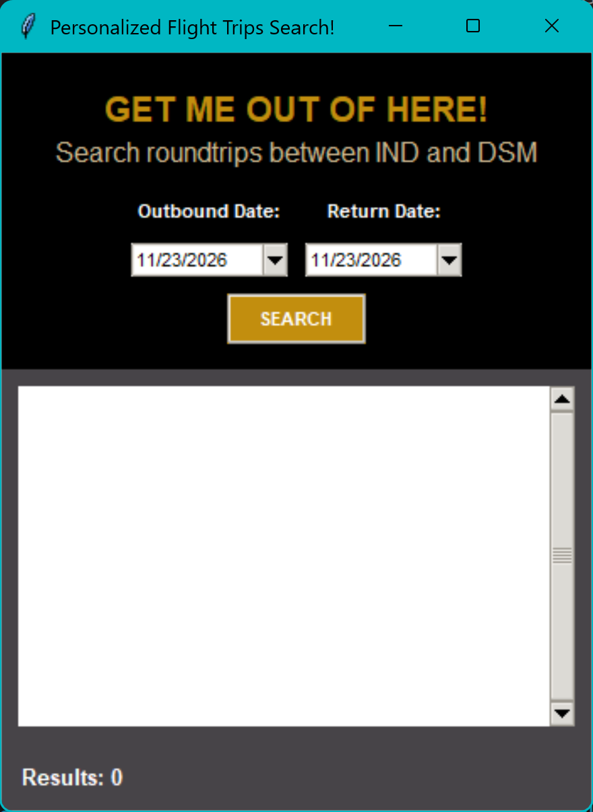
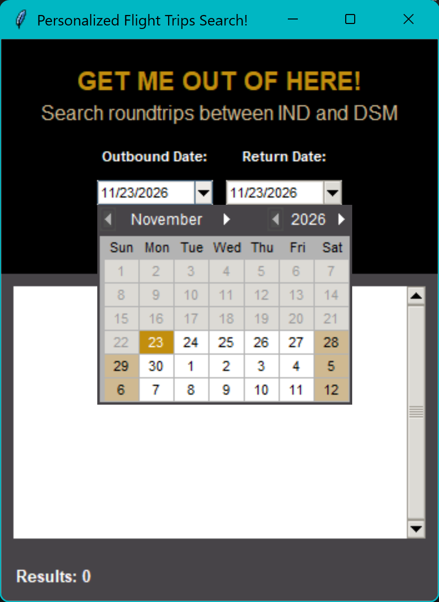
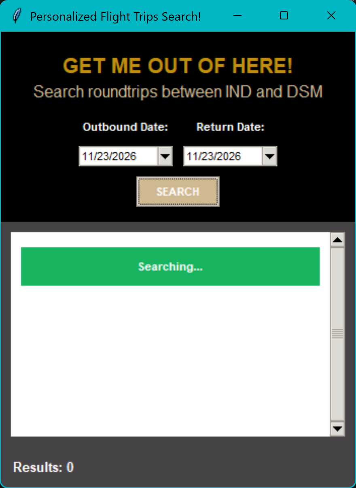
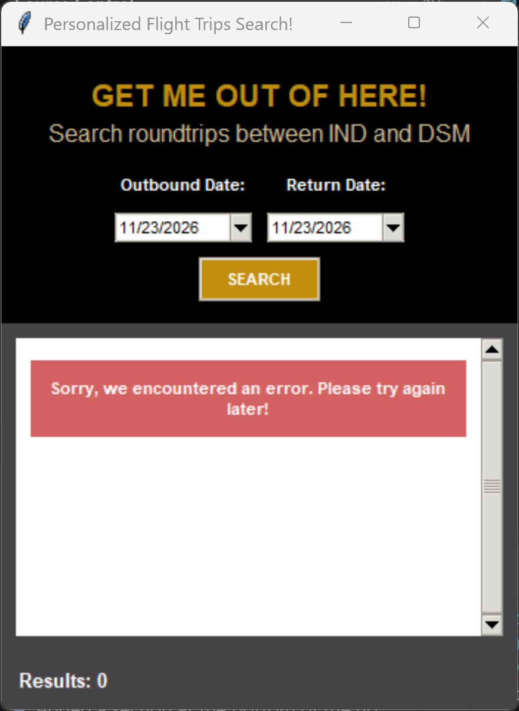
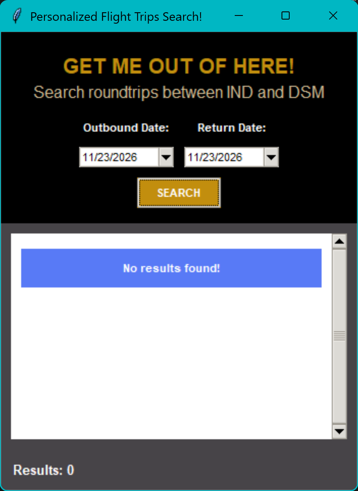
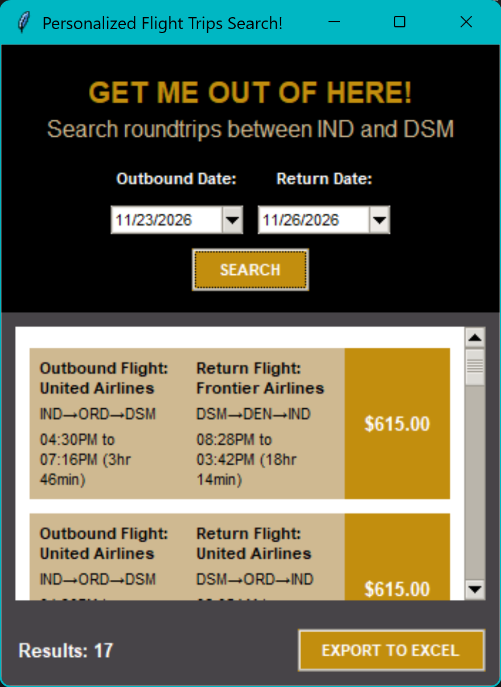
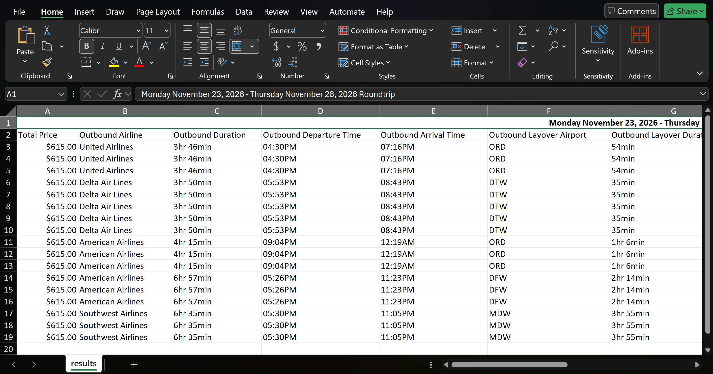
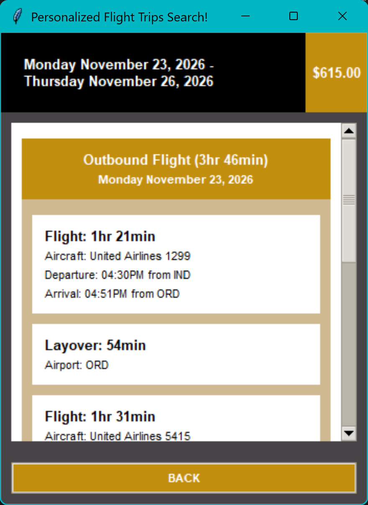

# Get Me Out of Here!✈️ - *Personalized Flight Trip Searching Tool*

This small Python program allows you to search for round trips between the Indianapolis International Airport (IND) and the Des Moines International Airport (DSM) on specific travel dates. 

<p align="center">
  
</p>

## The Problem

Because it is my first year at Purdue University, I look forward to visiting home during every break. However, since I live in Iowa, my family has to constantly search on Google Flights to find the cheapest trips between IND and DSM. This program intends to simplify the search process by saving consistent flight search criteria (passenger count, flight class, baggage count, etc.), so that the user only has to enter dates in order to find results.

## How It Works

The python script creates a `tkinter` GUI that enables the user to input a travel date for the departing and returning flight. Once the user submits the dates, the program uses the Python Library in [punitarani/fli](https://github.com/punitarani/fli) to search for trips via Google Flights and filter the results by the user-selected dates and the creator's standard flight requirements (1 adult passenger, economy class, 1 carry-on baggage, etc.). The matching results are displayed individually with basic information such as the total trip price, Airline Carrier, and flight timings. In the case an exception occured during the search or no results were found, a relevant message is displayed instead.

After the program displays at least 1 search result, the user is given options to further interact with the data. Clicking the "Export to Excel" button at the bottom of the search page will generate an excel sheet in the working directory. Clicking on an individual result will redirect the page to a detailed view of the trip plan. The user is free to exit this page and return back to the search page by clicking the "BACK" button at the bottom.


## Tech Stack

- **Language:** Python
- **Libraries:** `tkinter`, `tkcalendar`, [`Fli`](https://github.com/punitarani/fli), `datetime`, `threading`, `pandas`, `openpyxl`
- **External tools:** Google Flights, Excel

## Setup

1. If it isn't already, install Python on your system. Releases can be found on the [Python Downloads Page](https://www.python.org/downloads/).

> [!NOTE]
> If you use Ubuntu or Debian-based distributions, you may need to install `venv` separately before proceeding.
> ```bash
>sudo apt update
>sudo apt install python3-venv
>```

2. Download the code in the repository either through GitHub as a ZIP file or by using `git clone` in the command line (make sure you have git installed for this method!).

```bash
git clone https://github.com/lavanyaprem27/personalized-flight-trips-search.git
```

3. `cd` into the root folder in your system containing the code.

```bash
cd your\local\path\personalized-flight-trips-search
```

4. Create and activate the virtual environment. After this (venv) should appear at the start of a new terminal line.

```bash
#macOS/Linux
python3 -m venv .venv
source .venv/bin/activate

#Windows Command Prompt
python -m venv .venv
.venv\Scripts\activate.bat

#Windows PowerShell
python -m venv .venv
.\.venv\Scripts\Activate.ps1
```

5. Install the dependencies associated with the file

```bash
pip install -r requirements.txt
```
6. Run the main file of the program.

### Windows
```bash
python main.py
```

### macOS/Linux
```bash
python3 main.py
```

## Usage

1. Enter the travel dates in the fields labeled "Outbound Date:" and "Return Date". You can either type in the date in the MM/DD/YYYY format or by using the calendar popup. To exit the popup, first click on the calendar, then anywhere else in the window.

<p align="center">
  
</p>

2. Press the "SEARCH" button to submit the dates and begin the flight search. A temporary green message box with the words "Searching..." should appear.

<p align="center">
  
</p>

3. Occasionally, the fli library encounters an error when connecting with Google Flights and produces an exception. When this occurs, a red message box will appear. You are free to change the dates or submit again, but the best practice is to close the GUI and reopen it. If the error repeatedly occurs restarting the GUI, it is likely that fli's search methods have become outdated with Google Flights. Please submit a GitHub Issue, and I will work to fix this.

<p align="center">
  
</p>

4. When no results are found, a blue message box will appear with the message "No results found!". Please change the dates and resubmit to try again.

<p align="center">
  
</p>

5. If any results are found for the specified search, the bottom half of the page will be populated with yellow cards giving details for the outbound flight, return flight, and trip cost.

<p align="center">
  
</p>

6. After getting results, click the "EXPORT TO EXCEL" to generate an excel sheet in the working directory. The data in the cells will be formatted as text, so additional processing may be required to get it into a desired format.



7. After getting results, click on any result card to switch to a more detailed view of the trip result information. Click the "BACK" button at the bottom of the screen to return back to the search page.

<p align="center">
  
</p>

## Roadmap

### Minimum Viable Product *(Do)*:

- [X] User interface to select travel dates
- [X] View Google Flights trips matching user-selected dates and stored flight criteria
- [X] Sort resulting trips by total trip cost

### Scheduled Features *(Scheduled)*:
- [ ] Allow user to specify an acceptable range of dates/times for departing and return flight
- [ ] Option to only include flights with a layover time within a range
- [X] Export results to Excel using `pandas`


### Potential Features *(Delete)*:
- [ ] Support for manual selection of airports
- [ ] Advanced Flight Filtering (Ex. number of passengers, total flight time range, max connections, etc.)
- [ ] Allow user to select results to export


## Author

Lavanya Prem - Purdue University Undergraduate Student\
GitHub: [@lavanyaprem27](https://github.com/lavanyaprem27)
