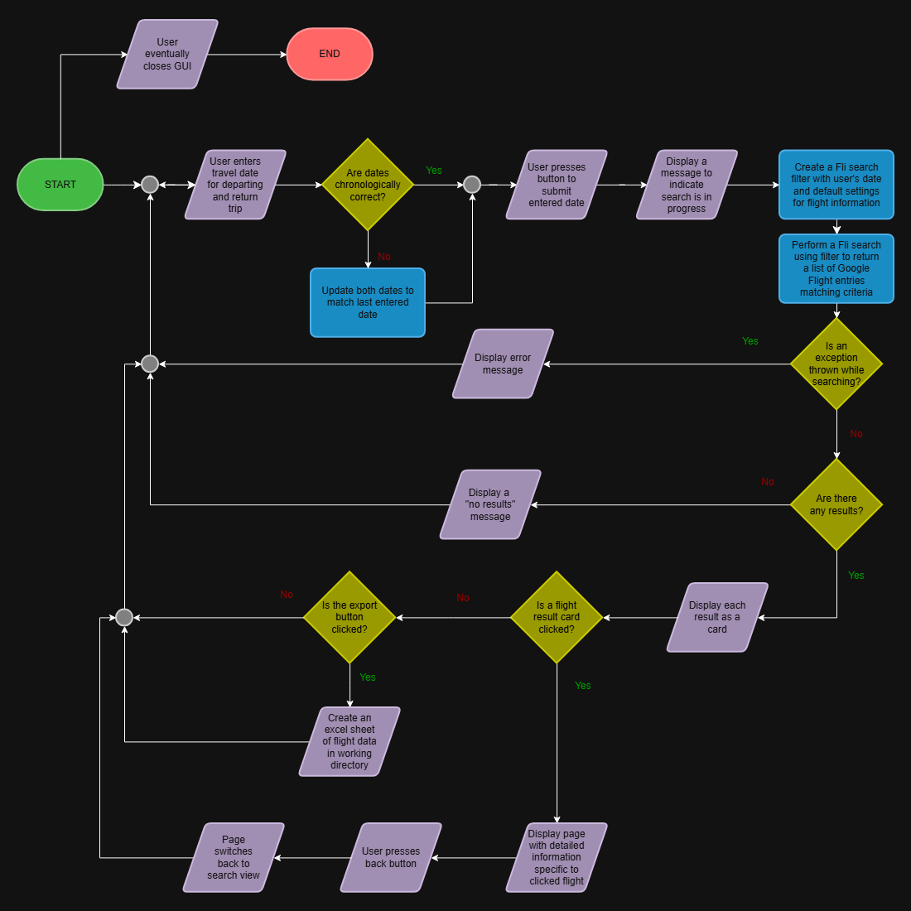
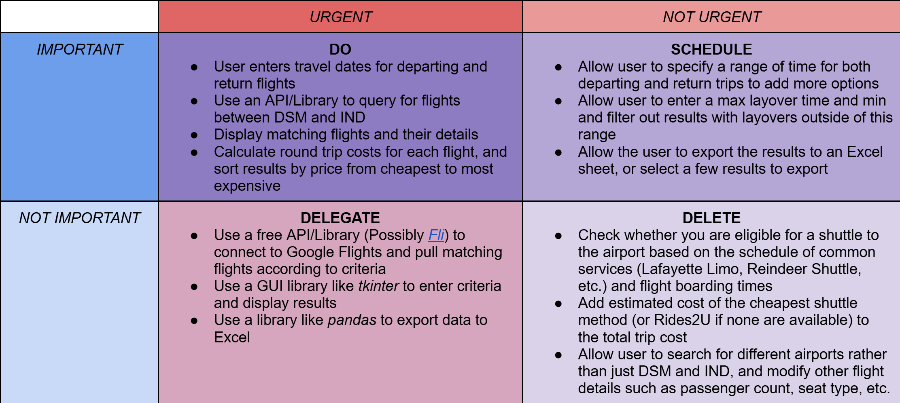

# Get Me Out of Here!✈️ - *Personalized Flight Trip Searching Tool*

This small Python program allows you to search for round trips between the Indianapolis International Airport (IND) and the Des Moines International Airport (DSM) on specific travel dates. 

## The Problem

Because it is my first year at Purdue University, I look forward to visiting home during every break. However, since I live in Iowa, my family has to constantly search on Google Flights to find the cheapest trips between IND and DSM. This program intends to simplify the search process by saving consistent flight search criteria (passenger count, flight class, baggage count, etc.), so that the user only has to enter dates in order to find results.

## How It Works

The python script creates a `tkinter` GUI that enables the user to input a travel date for the departing and returning flight. After verifying that the entered dates are valid, the program uses the Python Library in [punitarani/fli](https://github.com/punitarani/fli) to search for trips via Google Flights and filter the results by the user-selected dates and the creator's standard flight requirements (1 adult passenger, economy class, 1 carry-on baggage, etc.). The matching results are displayed individually with basic information such as the total trip price, Airline Carrier, and flight timings.



## Tech Stack

- **Language:** Python
- **Libraries:** `tkinter`, `tkcalendar`, [`Fli`](https://github.com/punitarani/fli)
- **External tools:** Google Flights

## Setup

1. If it isn't already, install Python on your system. Releases can be found on the [Python Downloads Page](https://www.python.org/downloads/).

2. Download the code in the repository either through GitHub as a ZIP file or by using `git clone` in the command line (make sure you have git installed for this method!).

```bash
git clone https://github.com/lavanyaprem27/personalized-flight-trips-search.git
```

3. `cd` into the root folder in your system containing the code.

```bash
cd your\local\path\personalized-flight-trips-search
```

4. Create and activate the virtual environment. After this (venv) should appear at the start of a new terminal line.

```bash
#macOS/Linux
python3 -m venv .venv
source .venv/bin/activate

#Windows Command Prompt
python -m venv .venv
.venv\Scripts\activate.bat

#Windows PowerShell
python -m venv .venv
.\.venv\Scripts\Activate.ps1
```

5. Install the dependencies associated with the file

```bash
pip install -r requirements.txt
```

## Usage

1. In the terminal, navigate to the directory with the downloaded project file.

```bash
cd path\to\file
```

2. Run the main file of the program.

### Windows
```bash
python main.py`
```

### macOS/Linux
```bash
python3 main.py`
```

## Roadmap

### Minimum Viable Product *(Do)*:

- [X] User interface to select travel dates
- [X] View Google Flights trips matching user-selected dates and stored flight criteria
- [X] Sort resulting trips by total trip cost

### Scheduled Features *(Scheduled)*:
- [ ] Allow user to specify an acceptable range of dates/times for departing and return flight
- [ ] Option to only include flights with a layover time within a range
- [ ] Export results to Excel using `pandas`


### Potential Features *(Delete)*:
- [ ] Support for manual selection of airports
- [ ] Advanced Flight Filtering (Ex. number of passengers, total flight time range, max connections, etc.)
- [ ] Allow user to select results to export



## Author

Lavanya Prem - Purdue University Undergraduate Student\
GitHub: [@lavanyaprem27](https://github.com/lavanyaprem27)
